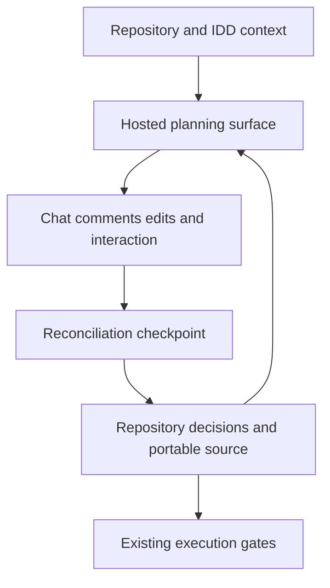

# Guildhall collaborative planning with durable artifacts

- Status: draft design; disposable adapter spikes completed; production implementation pending.
- Issue: [64](https://github.com/GrillerGeek/guildhall/issues/64).
- Repository baseline: `530d5cf` on branch `Artifacts`.
- Review Page: [Draft Guildhall collaborative planning design](https://chatgpt.com/space/page_4e1962051cf48191890273dbf93560bc). Private personal Page; sharing has not been changed.
- Initial Page snapshot: sequence 0, created and read back on 2026-10-18.
- Implementation proposal: [prose specification](2026-10-18-collaborative-planning-spec.md), added to the same review Page at sequence 8.

Guildhall should use Claude artifacts and ChatGPT Space Pages for collaborative planning, while keeping accepted decisions and portable review material in source control. This is a draft design for [issue 64](https://github.com/GrillerGeek/guildhall/issues/64), not an execution approval.

## Decisions agreed so far

- Planning artifacts should be durable.

- Use the fullest collaboration experience supported by the active host, including chat, selection comments, direct edits, and interactive controls.

- ChatGPT Space is the intended collaboration surface for Codex when its tools are available.

- Keep core requirements and lifecycle decisions in IDD documents where applicable.

- Use one review Page per quest.
- Decision authority follows the consuming project's designated owner, otherwise
  the initiating user.
- Retain substantive decisions and dispositions with source references, without
  copying entire conversations.

## Proposed planning loop

1. Read repository guidance, existing plans, and applicable IDD documents.

2. Open or create a linked review surface using the actual available host tools.

3. Present options, tradeoffs, unresolved questions, and useful interactive explanations.

4. Let users discuss, comment on selections, edit, and explore within the host surface.

5. At a review checkpoint, read the latest content and comments, compare them with the last saved repository revision, and reconcile decisions.

6. Save the accepted plan, unresolved items, and portable interactive source in the repository. Record the hosted link and last reconciled revision.

7. Before execution, verify that its inputs match the reviewed documents and that existing IDD gates are satisfied.



## Ownership and durability

The hosted surface is an active workspace for proposals and discussion. Repository documents are the execution inputs. Both can change during planning; a disagreement is a reconciliation task, not permission to overwrite either side.

Proposed ownership: preserve Mordain's plan-only writes and the existing native hooks. Extend Cassian's existing docs-writer role with a bounded review-document mode for named companion records and hosted review surfaces. IDD authoring stays with its authoring workflow. A Page chat does not inherit the coding session or lifecycle authority.

## Host behavior

| Surface | Proposed behavior | Evidence still needed |
| --- | --- | --- |
| Claude Code artifacts | Use native artifact collaboration and preserve a portable source copy | Verify feedback retrieval and exact revision mapping in a real session |
| Codex with Pages tools | Use a Page with native editable text, anchored comments, Page chat, and embedded visualizations as useful | Verify a user comment and Page chat can be collected into a repository checkpoint |
| Other hosts or unavailable integrations | Use local HTML and Markdown, collect feedback through the available conversation | Report which collaboration capabilities are unavailable |

## Feedback reconciliation

Preserve author, source reference, revision, and disposition for substantive feedback: accepted, rejected with rationale, deferred, or unresolved. Ordinary exploration of controls is not acceptance. AI suggestions are not human approval. Comments from other collaborators remain proposals unless the project's authorized decision maker accepts them.

Read before writing. If both the repository and hosted content changed since the last checkpoint, show the conflict and resolve the specific disagreement. Do not silently replace hosted edits or rewrite an execution plan from stale material.

Checkpoint on a request to save or proceed, before execution or a handoff, at closure, and when resuming after interruption. Continuous polling and unattended synchronization are outside the first version.

## First implementation slice

1. Add the portable review and reconciliation contract, including host discovery and fallbacks.

2. Define the planning bundle and a scoped Cassian review-document mode while preserving Mordain's plan-only writes.

3. Update native Claude and portable quest guidance, then regenerate the packaged skills.

4. Add isolated structural and conflict/recovery checks.

5. Run a small manual collaboration acceptance exercise on each supported host before claiming end-to-end support.

## Confirmed design choices

- Prefer one review Page per quest, with links to existing IDD documents, or separate Pages for substantial planning outputs? Recommendation: one Page per quest initially.

Accepted by Jason: one Page per quest.

- Who may accept decisions when several collaborators disagree? Recommendation: follow the consuming project's designated owner, otherwise the initiating user.

Accepted by Jason: the consuming project's designated owner, otherwise the initiating user.

- Should a checkpoint retain only decisions and dispositions, or also full comment transcripts? Recommendation: retain substantive decisions and dispositions, with source references; avoid copying entire conversations.

Accepted by Jason: retain substantive decisions and dispositions with source references, without copying entire conversations.

```codex-prompt
Review this Guildhall planning proposal with me. Focus on the open design choices and preserve the decisions already agreed. Record new suggestions as proposals. Changes to this Page do not by themselves update repository files or authorize execution.
```

## OpenCode and Pi support

Jason requested explicit investigation of both harnesses. The local browser-to-session round trip has now been exercised in both. Full hosted artifact collaboration remains unverified.

| Harness | Documented building blocks | Proposed integration |
| --- | --- | --- |
| OpenCode | Headless HTTP server, SDK session prompts and message reads, event subscriptions, custom tools | A browser review companion connected through a local adapter to a specific OpenCode session |
| Pi | TypeScript extensions with tools, commands, session state, user-message injection and terminal UI; RPC control | A Pi extension plus browser review companion, or an RPC client for a dedicated review session |

These are proposed integrations, not existing native artifact features. Highlighting, comments, shared review state, durable hosting, and collaborator access would need an existing compatible service or our own implementation. Reuse the same repository planning bundle and feedback format across adapters. A local browser bridge alone does not provide remote multiplayer collaboration.

Accepted by Jason: OpenCode and Pi adapter spikes are included in issue 64 before finalizing production adapter scope. Keep full-quest worker and isolation requirements separate from planning-surface support.

Sources checked on October 18 2026: [OpenCode SDK](https://docs.opencode.ai/docs/sdk/), [server](https://docs.opencode.ai/docs/server/), [custom tools](https://docs.opencode.ai/docs/custom-tools/), [Pi extensions](https://github.com/earendil-works/pi/blob/main/packages/coding-agent/docs/extensions.md), [Pi RPC](https://github.com/earendil-works/pi/blob/main/packages/coding-agent/docs/rpc.md).

## OpenCode and Pi adapter spikes

The two bounded discovery spikes below are complete for local transport and recovery. Their original scope is retained here; observed results and limitations follow. Production adapters remain to be designed.

| Spike | Question | Smallest experiment |
| --- | --- | --- |
| OpenCode | Can a browser planning surface exchange feedback with the intended session through supported APIs? | Render a saved proposal, submit one anchored comment or chat message through a local adapter, retrieve the response, and checkpoint the decision to the repository |
| Pi | Can an extension or RPC client support that same planning loop without depending on a terminal-only UI? | Render the same proposal, submit feedback through an extension or RPC connection, retrieve the response, and save a repository checkpoint |

For each spike, also check a session interruption/reconnect, duplicate submission handling, exact session binding, and preservation of local and hosted edits. Identify which capabilities come from the harness and which require a companion service.

Deliver a minimal disposable prototype, exact tested host version, reproduction steps, observed capability matrix, and a recommendation: native integration, companion adapter, or explicit fallback. Evaluate chat, selection comments, direct edits, interaction state, portable export, and remote collaboration separately. If a feature is absent, document the gap instead of building a collaboration platform inside the spike.

Use isolated project/client fixtures. No global installation, personal configuration changes, publication, or marketplace changes are needed for the experiments. Any live model usage should be identified before the probe runs. Durable multi-user hosting remains a separate design decision informed by the results.

## Remaining scope choices

- Review the proposed Cassian review-document mode; Mordain and the native hooks remain unchanged.
- Review the optional checkpoint/local companion helper and its bounded inputs,
  persistence, export and edge behavior in the linked implementation spec.

## Review checkpoint on October 18 2026

Source: linked review Page. Four open selection comments were read with attached,
untruncated selections; the listing reported truncated=false. Author: Jason
Robey. Reconciled Page content was read back at sequence 5.

| Source comment thread | Disposition | Result |
| --- | --- | --- |
| 4ea16be0-ea2e-42b1-9ec5-03061b9c0e5c | Accepted for discovery | Research added; Jason subsequently confirmed both spikes belong in issue 64 |
| 3d896d57-15a8-4d33-85ff-8cf0b06b4b99 | Accepted | One review Page per quest |
| 355bd63b-b2c6-4428-801e-103701e81e61 | Accepted | Project's designated owner, otherwise initiating user, decides |
| e0262c55-e901-46b7-b2ac-59884184c652 | Accepted | Save substantive decisions/dispositions with references |

The original commented text was retained in the Page and accepted-decision
paragraphs added beside it. Threads were left open for Jason; no replies,
notifications, or resolution actions were sent. This is design-review evidence,
not approval to execute a feature quest or change IDD status.


## Spike results

Completed the isolated OpenCode 1.19.3 and Pi 1.3.0 transport spikes on October 18 2026. Both used real installed harnesses with a synthetic local responder, without paid model calls or personal credentials.

| Check | OpenCode | Pi |
| --- | --- | --- |
| Browser selection comment, response, save and reload | Passed | Passed |
| Reopen exact session and send another prompt | Passed | Passed |
| Duplicate suppression and conflicting ID refusal | Passed | Passed |
| Pending submission retained without replay | Passed with seeded interruption state | Passed with seeded interruption state |
| Wrong session and stale checkpoint refusal | Passed | Passed |
| Unauthorized or cross-origin browser write refusal | Passed | Passed |

Recommendation: share the review document, feedback format, and checkpoint logic. Use OpenCode's HTTP session API and Pi's JSONL RPC as small host adapters. Pi does not need a custom terminal UI extension for this browser workflow.

These experiments did not establish live model quality, remote multi-user collaboration, concurrent hosted editing, shared control state, or a standalone offline export. The browser UI and persistence are supplied by our disposable companion, not native hosted artifact features.

Retained repository artifacts: `spikes/planning-artifacts/probe.py`, `review.html`, `results.json`, and `README.md`. Sessions and raw logs remain in temporary fixtures. Existing plugin behavior has not changed.

First-release scope for the implementation draft: native Claude artifacts and Codex/Space where callable, plus a local companion path for OpenCode and Pi. Integration with a hosted collaboration service for those harnesses is later work.

Full reproduction notes and evidence: [adapter spike report](../../spikes/planning-artifacts/README.md).
Results were saved to the review Page at sequence 7.


## Engineering detail for the proposed first slice

### Planning bundle

Keep the existing quest plan path and associate an explicit companion directory:

```text
docs/guildhall/plans/YYYY-MM-DD-slug.md
docs/guildhall/plans/YYYY-MM-DD-slug/
  review.html       # when an interactive explanation is useful
  review-state.json # bounded checkpoint metadata, not credentials
```

The exact record schema remains to be designed. It should identify the plan and
companion files with hashes, the host and stable hosted ID/URL, the last observed
host revision (or unknown), the last reconciled snapshot, linked IDD documents,
and substantive feedback dispositions. Store a small readable reconciliation
summary in the plan. Avoid private account identifiers and full chat dumps.
Do not make local filesystem paths the only navigation a hosted reader receives.

A portable source copy preserves the explanation and controls. It cannot promise
to preserve a provider's chat, comments, authentication, connectors, or shared
runtime storage. Material choices stored only in widget state must be written
into native Page text or a decision record before being used for execution.
Exported HTML should work without provider-specific APIs, with an explicit local
fallback for any interaction that originally submitted feedback to the host.

### Feedback and concurrency

Use a three-way comparison: the last reconciled snapshot, current repository
content, and current hosted content. Retrieve all available comment pages.
Retain comment/thread IDs and source revision when available; detached anchors
need human interpretation rather than an invented selection.

A Page chat is a separate interaction context. The session must not claim access
to arbitrary Page chat transcripts through the meeting-transcript tool. A useful
Page chat should save its proposed outcomes to native Page content or comments
so they are retrievable. If that write-back is unavailable, explicitly collect
the result through the user's conversation. Document capability limits without
discarding supported collaboration features.

Use observed revision/hash guards for hosted edits. Recheck local files before
saving. If the hosted write succeeds but the local save fails (or the reverse),
retain a pending checkpoint and resume from the observed state; do not mark both
sides synchronized or blindly replay a creation after an uncertain response.
Immutable or unsupported hosted revision metadata remains unknown.

Surface access failure, deleted content, renamed/moved local files, unavailable
comment tools, and unresolved concurrent edits. Retain the last durable copy.
These conditions do not authorize changing sharing settings, claiming complete
feedback coverage, or silently substituting stale execution inputs.

### Ownership and lifecycle boundary

Preserve Mordain's current plan-only contract, AGENTS.md and the native Write
guard. The implementation proposal instead gives Cassian a scoped review-document
mode for named companion and hosted review outputs. Update the portable entry,
native quest command and portable quest reference to dispatch that mode explicitly.
Preserve worker separation, established model aliases and native hook behavior.
Do not claim equivalent enforcement on Codex.

The existing IDD readiness preflight prohibits feature execution writes, including
the execution plan, before its gates pass. Pre-Spec collaborative discovery needs
an explicit separate authoring/design scope; it must not become an execution
plan that bypasses readiness. Changes to reviewed Spec content require its
existing review/readiness process. Unresolved architecture decisions return to
the appropriate authoring workflow.

Start with Mordain's planning/review handoffs and define a reusable presentation
contract for other planning agents. Do not expand Seraphine's inputs to include
interactive implementation proposals or Mordain's transcript.

### Expected implementation files

- New canonical portable reference for collaborative planning.
- Native quest command and portable SKILL/quest/host guidance.
- Cassian's bounded review-document mode, preserving its post-green mode and the
  existing native hooks.
- Build/validation resource inventory as required for the new reference.
- Generated plugin/skills bundles, regenerated rather than hand-edited.
- Contributor/user documentation, examples, and all installer-facing version
  manifests when the behavior ships.

### Acceptance and evidence

| Scenario | Required outcome |
| --- | --- |
| Page creation and read-back | Stable URL/ID, expected editable content, no duplicate after recovery |
| User selection comment | Correct selected text, author, disposition and saved decision |
| User Page chat | Proposed outcome written back into retrievable Page content/comments and reconciled |
| Interactive exploration | Controls work; shared state does not itself imply accepted decisions |
| Concurrent local and hosted changes | Specific conflict surfaced; neither side silently overwritten |
| Interrupted checkpoint | Resume without duplicate Page, lost comments or false synchronized state |
| Hosted surface unavailable | Durable source and decisions remain usable; precise capability gap reported |
| Multiple collaborators | Feedback retained; consuming project's decision authority honored |
| IDD and test-author boundaries | Existing gates and independent handoffs preserved |

Use isolated fake transport/fixtures for deterministic reconciliation and scope
checks if helpers are introduced. Run the documented build, validators, unit
suite and diff checks after implementation. Live host exercises are separate
acceptance evidence; do not call packaging tests proof of collaboration.

Current evidence: a private Page was created and read back through the live
Pages connector. Jason added four selection-anchored comments; all four were
retrieved with attached, untruncated selected text and author information.
The comment listing reported truncated=false. Three decisions were accepted
and saved in the Page at sequence 5, then read back and reconciled here.
Separate Page chat write-back, a Space interactive embed, sharing, and a Claude
artifact round trip remain unexercised. OpenCode/Pi companion browser interaction
and persistence have now been exercised; see the spike report for its limits.

### Next review

Review the linked implementation spec, especially the scoped Cassian mode,
optional helper, recovery semantics and proposed edge behavior. It uses native
hosted surfaces where callable and local companion support for OpenCode/Pi;
remote hosting for those two remains later work. The live Space comment round
trip and companion transport probes are complete. Detailed spec confirmation,
technical review and implementation verification remain pending.
